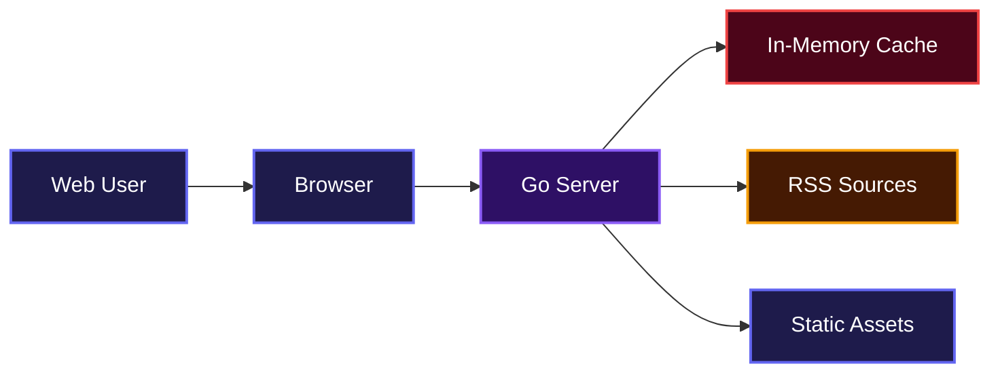
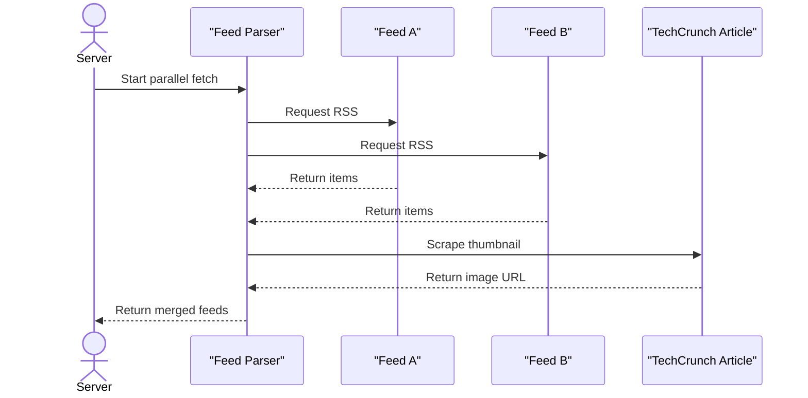
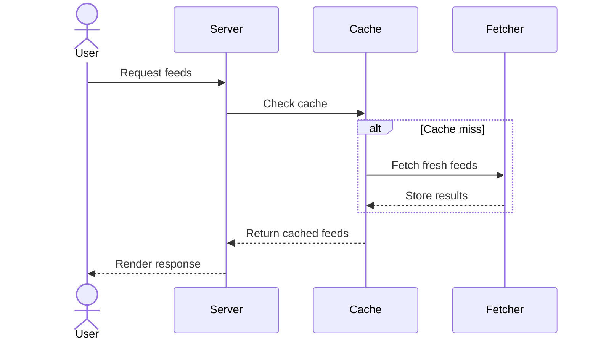
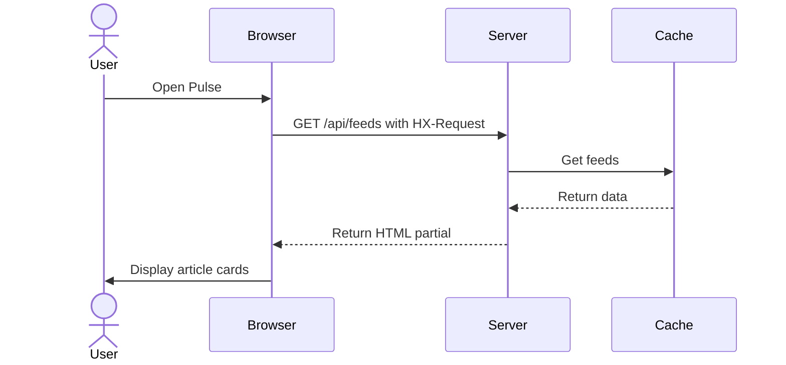
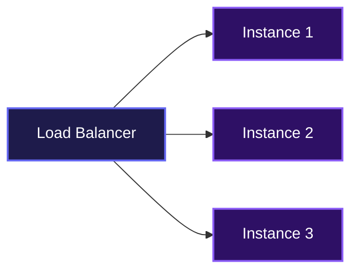

# Pulse

A lightweight, multi-instance RSS feed aggregator that pulls content from configured sources, caches it, and serves it through a clean web interface or a JSON API. It's built for developers who want a fast, simple way to collect and display news feeds without unnecessary complexity.

## Overview

Aggregates and displays RSS feeds from various sources in a clean, readable format. Stay updated with the latest news from TechCrunch, BBC News, and more! No bloat, no ads, just the content you care about.

## System Architecture



## Features

### Parallel Feed Fetching

Pulse fetches every configured RSS feed at the same time using goroutines. It also scrapes article pages for missing thumbnails when needed, so the reader always looks polished.



### Smart Caching with Warm Startup

Feeds are cached in memory for 15 minutes. On startup, Pulse warms the cache immediately so the first visitor never waits.



### HTMX-Powered Reader

The frontend loads feed cards without a full page refresh. When the browser requests `/api/feeds` with an HTMX header, the server returns an HTML partial instead of raw JSON.



### Multi-Instance Docker Deployment

The included Docker Compose file spins up three independent instances on different ports. Each instance knows its own name through an environment variable, which is useful for logs or load-balanced setups.



## Installation

1. Clone the repository:

```bash
git clone git@github.com:samueltuoyo15/Rss-Feed-Aggregator.git
cd Rss-Feed-Aggregator
```

2. Make sure you have Go 1.24.2 installed.

3. Download dependencies:

```bash
go mod download
```

4. Create a `config/feeds.yaml` file with your RSS sources:

```yaml
feeds:
  - name: "TechCrunch"
    url: "https://techcrunch.com/feed/"
  - name: "The Verge"
    url: "https://www.theverge.com/rss/index.xml"
```

5. Run the server:

```bash
go run main.go
```

The app will start on port 5000.

### Docker Setup

To run multiple instances locally:

```bash
docker-compose up --build
```

This starts three instances on ports 5001, 5002, and 5003.

## Usage

Open your browser and go to:

```bash
http://localhost:5000
```

The homepage loads feed cards automatically. If you want raw JSON instead of HTML, request the API directly:

```bash
curl http://localhost:5000/api/feeds
```

For an HTML partial that matches the frontend, add the HTMX request header:

```bash
curl -H "HX-Request: true" http://localhost:5000/api/feeds
```

## API Documentation

### GET /

**Description**: Serves the main Pulse reader page.

**Request**: No parameters required.

**Response**: Returns `text/html` containing the Tailwind-styled reader interface.

**Errors**:
- 500: Internal server error while rendering the homepage template.

### GET /api/feeds

**Description**: Returns the aggregated feed data. Returns JSON by default, or an HTML partial when requested via HTMX.

**Request**:
```bash
curl http://localhost:5000/api/feeds
```

Optional header:
```text
HX-Request: true
```

**Response (JSON)**:
```json
[
  {
    "Feed": {
      "name": "TechCrunch",
      "url": "https://techcrunch.com/feed/"
    },
    "Items": [
      {
        "title": "Sample Article",
        "link": "https://techcrunch.com/sample",
        "published": "Mon, 01 Jan 2024 12:00:00 GMT",
        "description": "A short summary.",
        "categories": ["Startups"],
        "content": "Full article content...",
        "author": null,
        "thumbnail_url": "https://example.com/image.jpg",
        "guid": "abc123"
      }
    ]
  }
]
```

**Response (HTML partial)**: Rendered `templates/feed_items.html` containing the article card grid.

**Errors**:
- 500: Failed to load or fetch feeds.

### Static Files

**Description**: Serves files from the `static/` directory under `/static/`.

**Request**:
```bash
curl http://localhost:5000/static/sitemap.xml
```

**Response**: Returns the requested static file.

## Environment Variables

| Variable | Description | Example |
|----------|-------------|---------|
| `INSTANCE_NAME` | Name of the running instance, useful for multi-instance logs and deployments. | `instance1` |

## Technologies Used

| Technology | Purpose |
|------------|---------|
| [Go](https://go.dev/) | Backend server and feed fetching |
| [gofeed](https://github.com/mmcdole/gofeed) | RSS and Atom feed parsing |
| [goquery](https://github.com/PuerkitoBio/goquery) | HTML scraping for thumbnails |
| [HTMX](https://htmx.org/) | Dynamic frontend updates without page reloads |
| [Tailwind CSS](https://tailwindcss.com/) | Styling for the reader interface |
| [Docker](https://www.docker.com/) | Multi-instance containerized deployment |

## Contributing

Contributions are welcome. If you want to add a feature or fix a bug, feel free to open an issue or pull request. Please keep changes focused and include a clear description of what you're changing.

## Author

- LinkedIn: [Samuel Tuoyo](https://linkedin.com/in/samueltuoyo)
- X: [@TuoyoS26091](https://x.com/TuoyoS26091)
- GitHub: [samueltuoyo15](https://github.com/samueltuoyo15)

## Badges

[](https://go.dev/)
[](https://www.docker.com/)
[](https://htmx.org/)
[](https://tailwindcss.com/)

[](https://dokugen.samueltuoyo.com)
